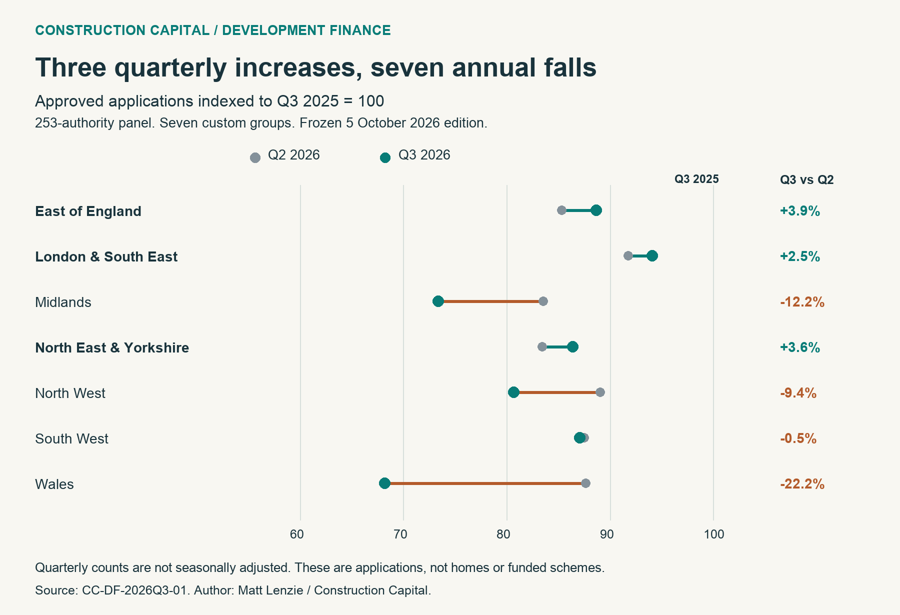

# Development Finance Q3 Planning Approvals Rise in Three Regions

A quarterly increase can change the tone of a development finance discussion. It needs an annual comparison beside it. In Construction Capital's 253-authority planning panel, approved applications rose between Q2 and Q3 2026 in three of seven regional groups. Every group still recorded fewer approvals than in Q3 2025.

This report compares the same three periods across all seven groups. It gives developers a practical way to describe local planning activity without treating one quarterly improvement as proof that planning risk has eased. Figures use the provisional Q3 series frozen on 5 October 2026.

Matt Lenzie | Construction Capital | 3 November 2026 | CC-DF-2026Q3-P08

## Where approvals increased during the quarter

London & South East recorded 2,319 approvals in Q3, up from 2,262 in Q2. That is 57 additional approvals, or 2.5%. East of England increased from 407 to 423, a rise of 16 or 3.9%. North East & Yorkshire increased from 619 to 641, a rise of 22 or 3.6%.

Those increases are visible in the latest quarter, but each group remained below its Q3 2025 count. London & South East was 5.9% lower year on year, East of England 11.3% lower and North East & Yorkshire 13.6% lower. The two comparisons answer different questions: whether activity increased from the preceding quarter, and whether it exceeded the same quarter a year earlier.

Q3 2025 equals 100 in each group. The green Q3 2026 dot is below 100 in all seven groups. A move right from the grey Q2 dot shows a quarterly increase. Separate regional indices compare changes, not the number of approvals between regions.

## The full regional comparison

The table retains the underlying counts so the changes can be checked. Across the full panel, approvals fell from 6,108 in Q2 to 5,983 in Q3, a decline of 125 or 2.0%. Compared with Q3 2025, the panel count was lower by 969 or 13.9%.

| Group | Q3 2025 | Q2 2026 | Q3 2026 | Quarterly change | Annual change |
| --- | ---: | ---: | ---: | ---: | ---: |
| East of England | 477 | 407 | 423 | +3.9% | -11.3% |
| London & South East | 2,465 | 2,262 | 2,319 | +2.5% | -5.9% |
| Midlands | 1,269 | 1,060 | 931 | -12.2% | -26.6% |
| North East & Yorkshire | 742 | 619 | 641 | +3.6% | -13.6% |
| North West | 668 | 595 | 539 | -9.4% | -19.3% |
| South West | 1,177 | 1,030 | 1,025 | -0.5% | -12.9% |
| Wales | 154 | 135 | 105 | -22.2% | -31.8% |
| Panel | 6,952 | 6,108 | 5,983 | -2.0% | -13.9% |

Counts are approved application records. Percentage changes are calculated from unrounded counts and rounded to one decimal place. Panel is the sum of the seven groups and must not be added to them again.

## Why the quarterly improvement needs context

A rise from one quarter to the next describes a short interval. It does not establish a sustained trend. Only three comparison periods are included here, and the quarterly counts have not been seasonally adjusted. The analysis cannot identify how much of a movement reflects seasonal patterns, the timing of decisions, the application mix or a lasting change in activity.

The annual comparison helps by using the same calendar quarter. It still reflects the conditions and mix of cases recorded in that earlier period. Neither baseline is sufficient on its own to predict the next quarter. A defensible appraisal can state both: quarterly approvals increased in three groups, while annual approvals remained lower in every group.

The [Construction Capital Q3 regional market report](https://constructioncapital.co.uk/market-reports/london-and-south-east-market-overview-q3-2026-review) provides the related website context. This visual comparison adds a two-baseline calculation to the same frozen evidence; it is a supporting analysis, with common authorship, rather than an independent confirmation of the source report.

## What a developer can use in a finance proposal

Regional activity can help frame the setting for a scheme. The proposal still needs evidence about the actual site. Start with the permission and its scope, relevant conditions and their status, and a dated programme showing when the scheme expects to move through its next stages. Explain which assumptions depend on a further decision or action.

For example, a scheme in East of England can accurately refer to a 3.9% quarterly increase in recorded approvals while acknowledging the 11.3% annual fall in the same panel. That combination supports a balanced description of the area. It does not establish that the scheme will secure permission faster, that conditions will be discharged, or that a lender will offer finance.

When assembling a [Development Finance proposal](https://constructioncapital.co.uk/services/development-finance/), use the local evidence to explain the programme and the assumptions that need checking. Construction Capital acts as a finance broker, not a lender. This planning comparison contains no loan offers, lending amounts, pricing, leverage measures or evidence of finance availability.

## Keep the units and the approval rate separate

One approved application is not one home, one construction start or necessarily one unique development. Counts can include different types and sizes of applications. The analysis has no application-level linkage with which to count unique schemes, follow a case through time or measure the duration of a decision.

The [Q3 planning pipeline definition dataset](https://huggingface.co/datasets/constructioncapital/q3-2026-planning-pipeline-definition-sensitivity) explains why application totals and proposed dwelling measures should remain separate. The [companion approval-rate analysis](https://wry-sing-81c.notion.site/Development-Finance-Why-a-Higher-Planning-Approval-Rate-Can-Still-Mean-Fewer-Approvals-40c03afc178981ddb0bff2210317574c) answers another question: why a higher share of decisions approved can coexist with fewer approvals. That rate-versus-volume result is distinct from the quarterly-versus-annual comparison shown here.

## Sources and reproducibility

The input is the 24-row planning_decisions.csv distributed with [the Q3 planning study at ICPSR](https://www.icpsr.umich.edu/sites/icpsr/view/studies/317061/versions/V1). It contains the panel and seven custom regional groups for Q3 2025, Q2 2026 and Q3 2026. The upstream source commit is 44ec7821f8bac827de198d09b4cca66725eae055. Public reproduction begins from those aggregate inputs, not from the private upstream extraction.

The 253 authorities comprise 19 in East of England, 102 in London & South East, 55 in Midlands, 20 in North East & Yorkshire, 27 in North West, 23 in South West and seven in Wales. This is a matched panel, not a national planning census or the standard set of statistical regions. The small Wales panel deserves particular caution when interpreting its percentage change.

The [backing data and calculation code](https://github.com/mattylll/cc-q3-2026-geographic-breadth/tree/codex/q3-geographic-breadth/audits/planning-baselines) contain all 24 source rows, eight derived panel/regional comparisons, checks and the chart. Quarterly change is Q3 2026 minus Q2 2026, divided by Q2 2026. Annual change is Q3 2026 minus Q3 2025, divided by Q3 2025. Each chart index divides a period's approvals by its group's Q3 2025 approvals, then multiplies by 100.

The original text, chart and analytical explanations are licensed CC BY 4.0; original code is MIT. The planning aggregates originate in Construction Capital's Landstack-derived export. No blanket open licence or rights to the underlying Landstack database or application-level records are granted. Retain the source attribution and consult the source rights holder for use beyond applicable rights.
